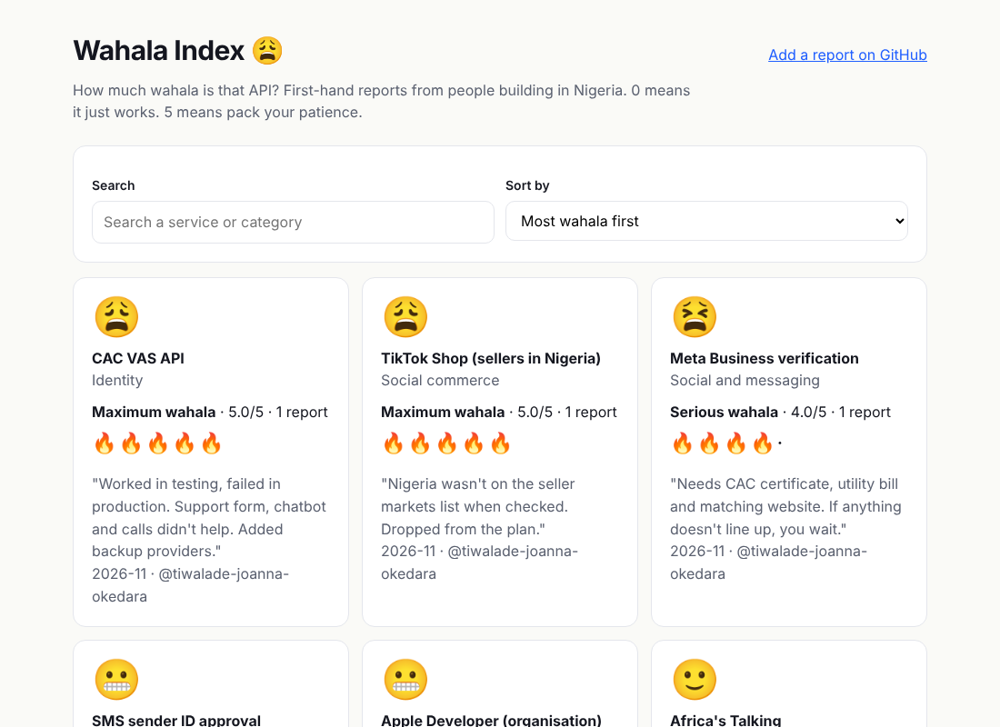

# Wahala Index 😩

**How much wahala is that API?** A small, community-built reliability board for the APIs and services Nigerian builders depend on: payments, identity checks, SMS, app stores, social platforms and more.

🔥 **Live board:** https://tiwalade-joanna-okedara.github.io/wahala-index/



| Score | Meaning |
|---|---|
| 0 😌 | No wahala. It just works. |
| 1 🙂 | Small wahala. |
| 2 😐 | Some wahala. |
| 3 😬 | Plenty wahala. Expect delays. |
| 4 😫 | Serious wahala. Have a plan B. |
| 5 😩 | Maximum wahala. Build a fallback before you launch. |

## Why

The most useful facts about an API rarely make it into its documentation. They live in builders' heads and group chats: which service fails in production, which approval takes weeks, whose support actually replies. This board collects those first-hand experiences, honestly and with dates, so the next builder can plan around them. For the full list of services, see [naija-api-directory](https://github.com/tiwalade-joanna-okedara/naija-api-directory).

## Add a report

1. Edit [`reports.json`](reports.json) and add an object:
   ```json
   {"service": "Service name", "category": "Payments", "wahala": 2, "date": "2026-11", "by": "your-github-username", "note": "What you tried and what happened."}
   ```
2. Keep it first-hand and factual. No adverts, no insults, no affiliate links.
3. Open a pull request. Scores are averaged per service on the live board.

## Run it locally

It's a single static page. Serve the folder with any static server (for example `npx serve .`) and open it in your browser.

---
Made by [Tiwalade Joanna Okedara-Kalu](https://github.com/tiwalade-joanna-okedara) · MIT licence
